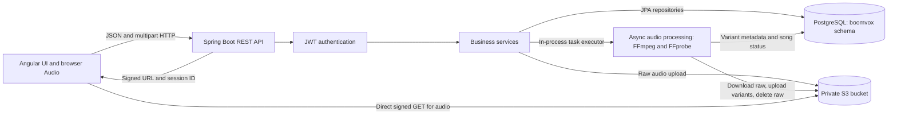
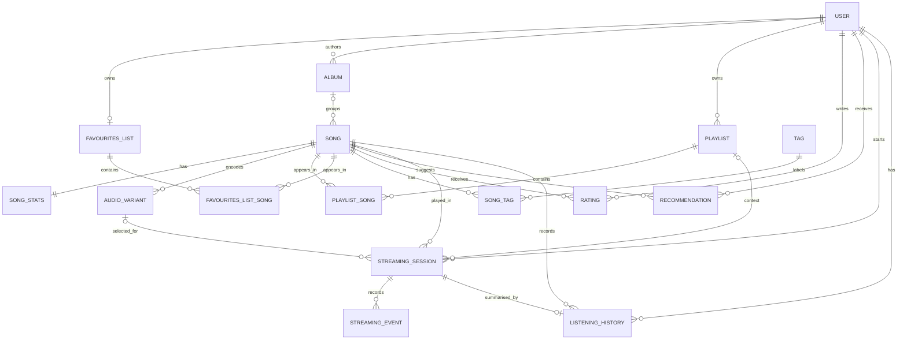

# Architecture

This document describes the source reviewed on 2026-10-29. Boomvox has an Angular single-page application and one Spring Boot backend process. PostgreSQL holds application data, and S3 holds audio. There is no current hosted deployment.

## Components



The backend is a layered monolith. Controllers map HTTP requests and DTOs; services implement business operations; Spring Data repositories access entities. `StreamingController` also reads repositories directly to select audio variants. Audio processing runs in the same JVM, using an executor with 2 core threads, 4 maximum threads, and queue capacity 50. There is no external job broker or separate worker service.

The frontend uses standalone components, router providers, signals, and RxJS HTTP requests. Application-scoped services retain user/catalogue state and the audio player across route changes. There is no server-side rendering configuration or global state-store package in the checked-in source. Missing frontend build metadata prevents a complete dependency/version inventory.

## Data model

Liquibase's master changelog includes 21 SQL files. Development uses database `postgres` and schema `boomvox`, with Hibernate configured to validate mappings after migration. Several entity mappings, SQL queries, and migration 021 explicitly name `boomvox`, so changing only the connection's schema is insufficient to rename it.



The diagram reflects the intended SQL relationships after all included changes. In particular, migration 021 makes `song.album_id` optional, while the `Song` JPA mapping still declares it non-nullable; this inconsistency is a known problem. The existing [database image](db_er_diagram.png) is a historical illustration and may omit newer entities/changes.

| Concept | Representation |
| --- | --- |
| Artist | A `User` with role `AUTHOR`; there is no separate artist entity |
| Genre | Enum on `Album`; a song's genre and artist are inferred through its album |
| Audio metadata | `Song`, one `SongStats`, and multiple `AudioVariant` rows |
| Personal collections | `Playlist`/`FavouritesList`, with ordered song membership rows |
| Feedback | One rating per user/song composite ID, containing grade 0–10 and a comment |
| Discovery | Persisted recommendations keyed by user/song; preferences calculated on demand |
| Listening | Session, timestamped events, and at most one history row per session |

S3 objects are not database blobs. `Song.storageKey` initially holds the raw object key; variants hold their own streaming keys. The original raw object is deleted on successful processing, but the song's original key is not replaced. Client DTOs currently expose `storageKey`; this is documented as an issue rather than an opaque playback URL.

## Registration and request authentication

Registration creates an ordinary user and a favourites list and returns a JWT. Login authenticates by email/password. Passwords use Spring's delegating password encoder. The JWT subject is the username, includes a role claim, and expires after one hour by default.

For Bearer requests, `JwtAuthenticationFilter` verifies the signature/expiry and loads the current user by username. The principal's authorities come from that database user. Spring Security is stateless; backend logout does not revoke issued tokens. Renaming a username can invalidate the lookup for an existing token.

The HTTP security chain permits `/api/auth/**` and the Swagger/OpenAPI paths, restricts `/api/admin/**` to `ADMIN`, and requires authentication everywhere else. A `GUEST` is an enum role on an authenticated account, not anonymous access. Catalogue mutations declare `AUTHOR`/`ADMIN` annotations, but method security is not enabled. See [access-control gaps](known-problems.md#authentication-and-access-control) before treating annotations as enforced permissions.

## Audio upload and processing

```mermaid
sequenceDiagram
    participant UI as Angular upload page
    participant API as SongController / SongService
    participant DB as PostgreSQL
    participant S3 as S3
    participant Worker as AudioProcessingJob

    UI->>API: POST /api/songs (audio + JSON metadata)
    API->>S3: Upload raw/uploads/song_UUID_filename
    API->>DB: Save song and stats; PROCESSING
    API->>Worker: Submit async processing task
    API-->>UI: 201 SongResponse
    Worker->>S3: Download raw audio to temporary disk
    Worker->>Worker: Probe duration; encode three variants
    Worker->>S3: Upload variants/song_ID_BITRATEk.EXT
    Worker->>DB: Save READY variants; update duration and ACTIVE status
    Worker->>S3: Delete raw object
    UI->>API: Poll GET /api/songs/ID every three seconds
    API-->>UI: processingStatus
```

The controller accepts only `audio/mpeg` and `audio/wav`, with a 100 MiB code-level file limit. Development also configures 100 MB servlet file/request limits; multipart overhead means a file at the exact request limit can be rejected earlier. FFprobe measures duration; FFmpeg creates 128 kbps MP3 (default), 320 kbps MP3, and 256 kbps AAC variants. On a caught processing exception, the job attempts to mark the song `FAILED` and cleans up known temporary paths.

The async task is submitted before the upload transaction commits. The sequence above describes the code path, not a guarantee that the worker can already read the new song. Task durability, transaction timing, failed-job retries, and partial S3 cleanup remain [known issues](known-problems.md#audio-and-playback).

## Playback and activity

1. The UI requests `GET /api/songs/{songId}/stream` with a Bearer token.
2. The backend requires an `ACTIVE` song and selects a `READY` variant: default for `GUEST`, highest bitrate for `ORDINARY_USER`, `AUTHOR`, or `ADMIN`.
3. It signs the variant's S3 GET URL, opens an `ACTIVE` streaming session, records `START`, and returns URL, expiry, session ID, duration, bitrate, and format.
4. The browser audio element reads the object directly from S3. Audio bytes do not pass through Spring Boot.
5. The UI posts pause/resume/seek events and patches session status when playback ends or the track changes. `PlaybackService.endSession` stores a history row if the session has none.

Listening duration currently uses wall-clock time since session start, capped by song duration, rather than elapsed audio playback. Pauses therefore affect the measurement. Playback completion does not increment the song play counter in the current implementation. The frontend's unload/logout status also differs from the backend enum.

Every stream URL request creates another session, including a URL refresh. The URL signer reads configurable expiry minutes, while the response expiry is hardcoded to 15 minutes. No HLS/DASH segments, CDN, adaptive streaming, distributed queue, or URL cache are implemented.

## Recommendations

`UserPreferenceService` builds per-song preference scores from:

- Listening history: `min(listenedDuration / songDuration, 1)` when duration is positive.
- Favourites: +4 per favourite song.
- Ratings: `grade - 5`, allowing negative feedback.

It aggregates these scores by album genre, album author, and song tags. Scores are raw sums, not probabilities. Albumless songs have no artist/genre contribution.

`RecommendationService` considers `ACTIVE` songs, excludes previously listened-to and favourited songs, and calculates:

```text
score = 3 × genrePreference
      + 2 × artistPreference
      + averageTagPreference
      + 0.25 × (averageRating / 10 + log(1 + playsCount))
```

It discards negative scores, sorts descending, limits the result, and normalises each score to 0–100 relative to the highest returned score. Generation replaces that user's saved recommendations. The default limit is 20 and allowed limits are 1–100. The click endpoint only retrieves a saved recommendation; it does not currently record click analytics.

The implementation scans the catalogue and performs per-song tag lookups, so query volume grows with catalogue size. No LLM call is part of this path, even though AI-related dependencies/configuration remain.

## Operations and further reading

The current runtime target is local development. PostgreSQL and S3 are external dependencies; FFmpeg, temporary disk space, and background threads are on the backend host. There is no checked-in container definition, deployment automation, hosted URL, or configured health endpoint.

See [deployment/configuration](deployment.md), [API contracts](project-endpoints.md), [frontend internals](../Frontend/Boomvox_UI/README.md), and [known problems](known-problems.md) for setup and practical limits.
